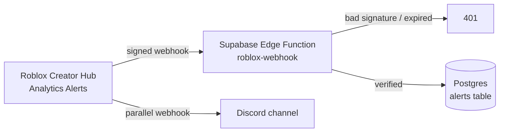

# roblox-alerts

A webhook service that receives analytics alerts from Roblox Creator Hub, verifies that each one really came from Roblox, and records every incident's **fired → recovered** lifecycle in Postgres.

It was built after a production incident on a live multiplayer Roblox game averaging ~800 concurrent players: a bug dropped peak-hour players by ~85%, and nothing notified anyone. Roblox can evaluate alert rules, but it only delivers them to a webhook URL — this service is the receiving end, and the foundation for an iOS app with push notifications.

## How it works



1. Roblox evaluates an alert rule (for example, *concurrent players ≤ X for 6 consecutive minutes*) and sends a signed `POST`.
2. The Edge Function verifies the signature and timestamp before parsing anything.
3. The event is upserted into `alerts`, keyed by Roblox's `NotificationId`.
4. A separate Discord webhook provides phone notifications for now; an iOS app is in progress.

## Security

- **HMAC-SHA256 signature verification.** Roblox signs `"<timestamp>.<body>"` with a shared secret. The function recomputes the signature with the Web Crypto API and rejects mismatches with `401`. Supabase's JWT check is disabled for this function because Roblox can't send a Supabase token, so the signature *is* the authentication.
- **Replay protection.** Requests whose timestamp is more than 5 minutes from the current time are rejected. The timestamp is part of the signed string, so it can't be changed without breaking the signature.
- **Constant-time comparison**, so response timing doesn't reveal how much of a forged signature was correct.
- **Raw-body hashing.** The body is read as text before parsing, because re-serializing JSON can change the bytes. A fallback also accepts the compact `JSON.stringify` form, matching Roblox's reference implementation.
- **Least privilege in Postgres.** Row-level security is enabled with no policies, and table grants are revoked from the public `anon` and `authenticated` roles. Only the function's server-side key can read or write.
- **No secrets in the repo.** The webhook secret lives in Supabase's secret store.

## Data model

| Column | Type | Notes |
|---|---|---|
| `notification_id` | `text`, unique | Roblox's event ID. Duplicates are skipped (`ON CONFLICT DO NOTHING`), so handling is idempotent. |
| `universe_id` | `text` | The experience the alert belongs to. |
| `metric` | `text` | e.g. `PeakConcurrentPlayers` |
| `status` | `text`, check | `fired` or `recovered`, parsed from the summary. |
| `summary` | `text` | Roblox's human-readable summary. |
| `current_value` | `text`, nullable | Stored raw (see below). |
| `evaluated_at` | `timestamptz` | When Roblox evaluated the rule. |
| `received_at` | `timestamptz` | When this service received it. |
| `raw` | `jsonb` | The full original payload, so events can be re-parsed if the format changes. |

Indexed on `(universe_id, evaluated_at desc)` for the "latest alerts for my game" query. Schema lives in [`supabase/migrations`](supabase/migrations).

## What real payloads taught me

Findings from testing against live alerts, beyond what the documentation covers:

- `AlertMessage` is a **JSON string inside the JSON body**, so it has to be parsed twice.
- `current_value` doesn't appear in the documented example payload. With a platform breakdown it packs every segment into one string (`"-0.071(Computer), -0.109(Console), …"`), and **"recovered" events omit it entirely** — hence nullable `text`.
- In testing, **Roblox did not retry** a delivery that was rejected with `401`. A failed delivery means a lost alert.
- A minute-granularity alert fired about **10 minutes** after its condition became true; half-hour alerts take longer because the window has to close first.
- An alert's breakdown setting couldn't be changed after creation in the Creator Hub UI. With a platform breakdown, a player-count floor is checked per platform, where each value is far below the total, so it fires constantly.

## Setup

Requires the [Supabase CLI](https://supabase.com/docs/guides/cli).

```bash
supabase link --project-ref <your-project-ref>
supabase db push                                   # creates the alerts table
openssl rand -base64 32                            # generate a webhook secret
supabase secrets set ROBLOX_WEBHOOK_SECRET="<secret>"
supabase functions deploy roblox-webhook
```

Then in **Creator Hub → Configure → Webhooks**, add
`https://<your-project-ref>.supabase.co/functions/v1/roblox-webhook` with the same secret and the analytics alert trigger. **Test Response** should return `200`; a wrong secret should return `401`.

## Roadmap

- [ ] iOS app (SwiftUI): incident timeline and push notifications
- [ ] In-game error-rate reporter, since Creator Hub can't alert on error counts
- [ ] Baseline detection using the median of the last 3–4 weeks at the same hour, so one bad week can't skew it
- [ ] Backfill missed alerts from the Analytics Query API
- [ ] Keep-alive ping so the free-tier project never pauses before an incident

## Stack

TypeScript (Deno) · Supabase Edge Functions · Postgres · Roblox Open Cloud webhooks
